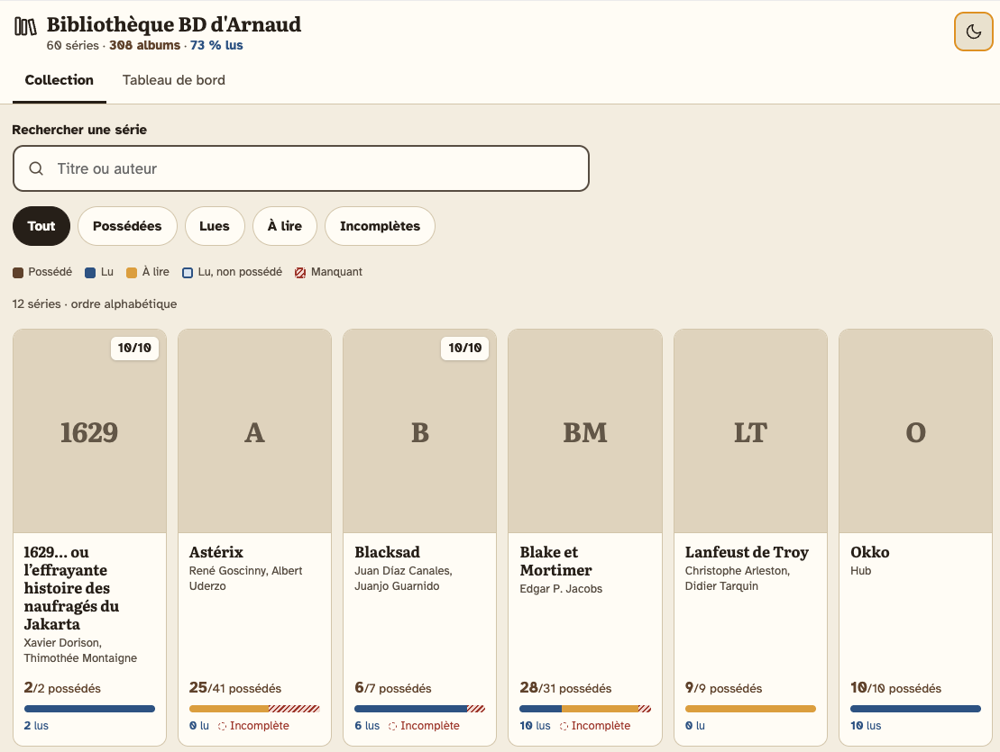
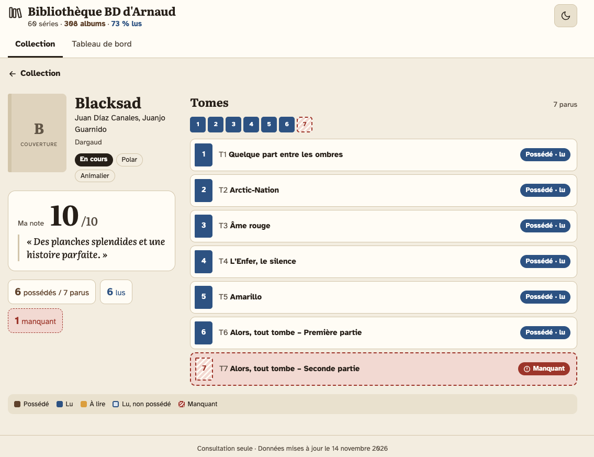
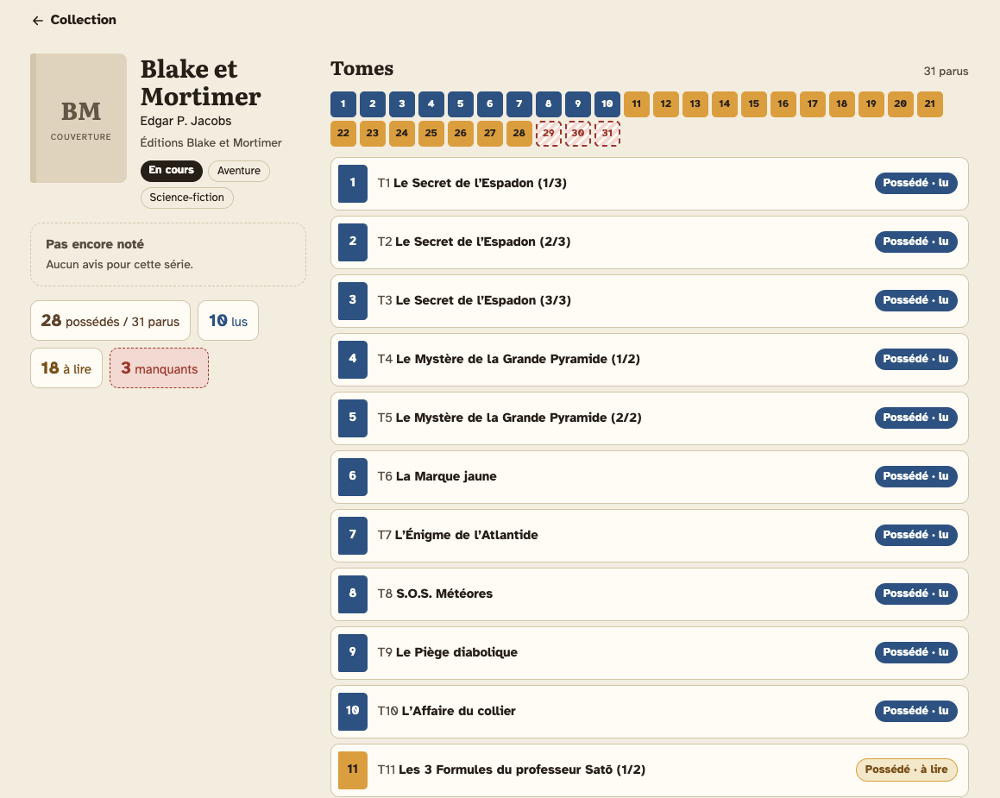
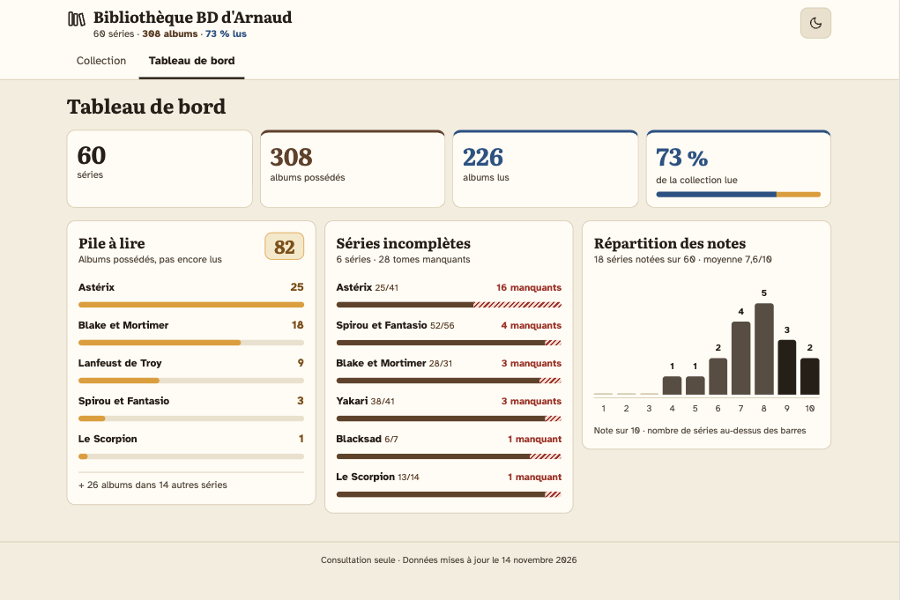
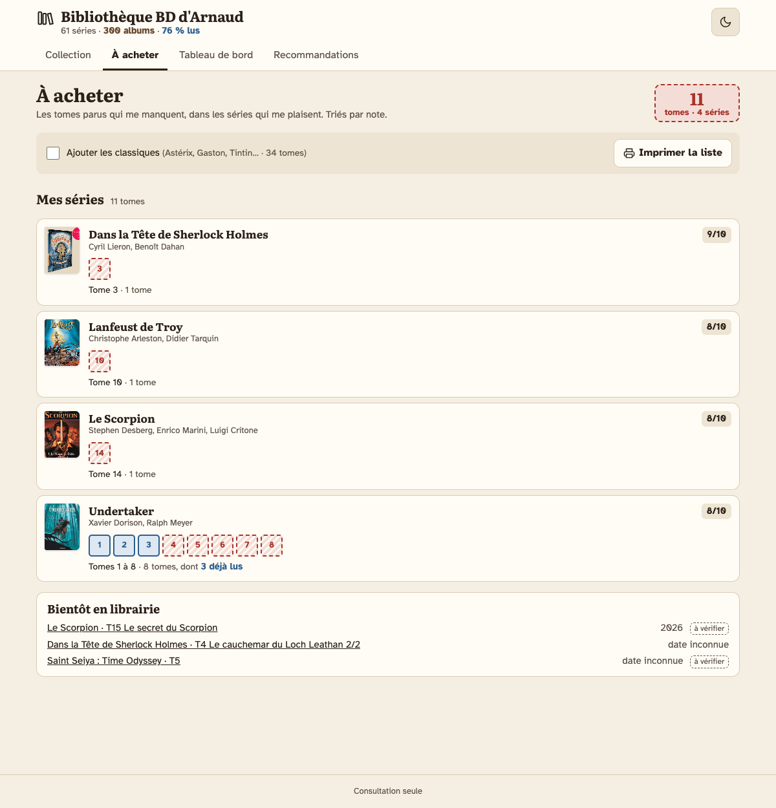
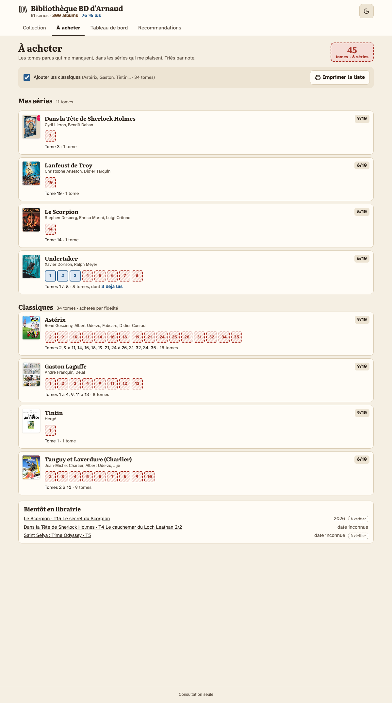
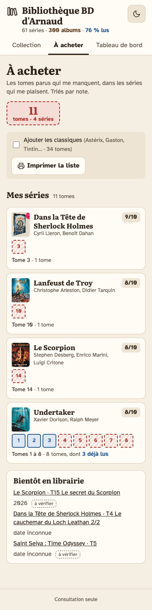
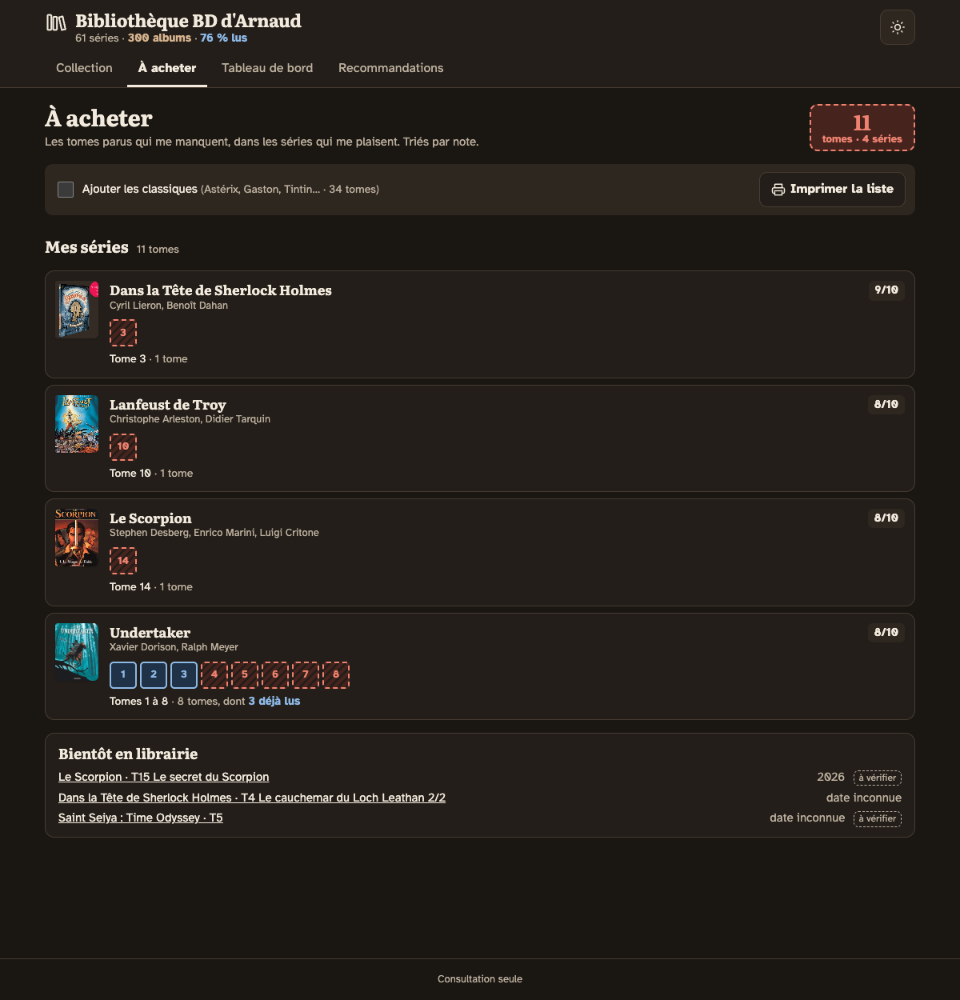

# Mockups — référence visuelle

Maquettes réalisées dans Claude Design et validées par Arnaud le 2026-11-14.
**Elles font référence** pour l'implémentation des écrans (US-02, US-03, US-04, US-06, US-07, US-08).

- Canvas interactif (privé, à partager depuis Claude) : https://claude.ai/artifact/CZ3m8eWLgXbqne4tLWMdE2
- Sources des maquettes : [`source/`](source/). Ce sont des fichiers Claude Design (`.dc.html`) qui ne s'ouvrent pas seuls dans un navigateur, mais ils donnent les styles exacts, les textes et la logique de calcul.

| Écran | Fichier site | Source maquette | Variantes sur le canvas | Issues |
|---|---|---|---|---|
| 1. Ma collection | `index.html` | [`01-collection.dc.html`](source/01-collection.dc.html) | mobile, aucun résultat, sombre, desktop | US-02, US-03, US-06, US-07 |
| 2. Page série | `serie.html?id=…` | [`02-page-serie.dc.html`](source/02-page-serie.dc.html) | Blacksad (noté, 1 manquant), Undertaker (lu non possédé), Blake et Mortimer (sans note, à lire), sombre, desktop | US-04, US-06, US-07 |
| 3. Tableau de bord | `stats.html` | [`03-tableau-de-bord.dc.html`](source/03-tableau-de-bord.dc.html) | mobile, sombre, desktop | US-08 |
| 5. À acheter | `envies.html` | [`05-envies.html`](source/05-envies.html) (HTML statique, données réelles du 2026-11-14) | captures : défaut, avec classiques, mobile, sombre | US-18 |
| 7. Thème « Planche » (validé le 2026-11-15, appliqué) | toutes les pages | [`07-theme-planche.css`](source/07-theme-planche.css) (surcouche chargée après `css/style.css`) | captures : [collection](07-planche-collection.png), [série Blacksad](07-planche-serie-blacksad.png), [tableau de bord sombre](07-planche-tableau-sombre.png), [mobile](07-planche-mobile.png) | US-27 |

### Captures (desktop, mode clair)

| Ma collection | Page série — Blacksad | Page série — Blake et Mortimer | Tableau de bord |
|---|---|---|---|
|  |  |  |  |

Les autres variantes (mobile, sombre, aucun résultat, Undertaker) sont sur le canvas.

## Charte

Depuis le 2026-11-15, le site applique le **thème « Planche »** (US-27, ton comics validé par Arnaud) : chaque écran est une planche de BD.
Captures et source de la maquette : ligne 7 du tableau ci-dessus.

### Codes graphiques « Planche »
- **Papier tramé** : fond `--bg` couvert de points (`--trame`, 9 px), comme les points Ben-Day des vieux albums. Pas de trame à l'impression.
- **Trait encré** : bordures `--ink` de 2 à 3 px (`--encre`), coins quasi droits (2–4 px), **ombres portées dures** (`--ombre` 4 px, `--ombre-s` 3 px), aucun flou.
- **En-tête façon couverture** : bandeau jaune tramé de rouge, identique en clair et en sombre ; titre en Bangers blanc cerné de noir, légèrement penché ; statistiques dans un **cartouche** de récitatif ; onglets en petites cases, l'onglet actif noir sur jaune.
- **Cartouches** jaunes pour les titres de page et de section (`.page-title`, `.panel h2`, `.tomes-head h2`…).
- **Cases** : les cartes série sont un peu de travers (−0,6° / +0,5°) et se redressent au survol ; aucune rotation avec `prefers-reduced-motion: reduce`.
- **Note en explosion** jaune (SVG en fond) sur la couverture ; sur la page série, grande note rouge et **avis dans une bulle** avec sa pointe.
- **Recherche en bulle** de dialogue. Bouton ou filtre actif : fond `--rouge`, texte `--onrouge`.

### Typographie (Google Fonts)
- Lettrage : **Bangers** 400 (titre du site, titres de page et de série, note, chiffres clés, initiales de couverture).
- Titres de section et de carte : **Comic Neue** 700, souvent en capitales.
- Texte : **Atkinson Hyperlegible** 400/700, 16 px, interligne 1.45. Libellés secondaires 13–14 px. Inchangé pour la lisibilité.

### Couleurs (variables CSS, clair / sombre)

| Variable | Rôle | Clair | Sombre |
|---|---|---|---|
| `--bg` | fond de page | `#F3EAD3` | `#14171F` |
| `--surf` | cartes, en-tête | `#FFFDF5` | `#1E2230` |
| `--surf2` | fond de barre, bouton thème | `#F7E7B5` | `#2A2F40` |
| `--line` | bordures | `#1B1B1B` | `#F2EADD` |
| `--ink` | texte | `#1B1B1B` | `#F2EADD` |
| `--ink2` | texte secondaire | `#4A4339` | `#BDB4A6` |
| `--own` | **possédé** | `#6B4A2F` | `#D6B38E` |
| `--read` | **lu** | `#2C5F8F` | `#8DB8E6` |
| `--onread` | texte sur `--read` | `#FFFFFF` | `#10202F` |
| `--readtint` | fond « lu, non possédé » | `#DDE8F3` | `#1F3247` |
| `--toread` | **à lire** | `#E3A43A` | `#E9B455` |
| `--ontoread` | texte sur `--toread` | `#2B2119` | `#1A1612` |
| `--toreadtxt` | texte « à lire » | `#875810` | `#F0C470` |
| `--toreadtint` | fond « à lire » | `#F7EAD0` | `#3A2D17` |
| `--miss` | **manquant** | `#A8352A` | `#EE8270` |
| `--misstint` | fond « manquant » | `#F5DDD7` | `#47231D` |
| `--cover` | couverture par défaut | `#E4D8C3` | `#2A2F40` |
| `--covertxt` | initiales sur couverture | `#5A4E40` | `#BDB4A6` |
| `--jaune` | bandeau, cartouches, explosion de note | `#FFD23F` | `#FFC930` |
| `--rouge` | filtre ou bouton actif, grande note, coup de cœur | `#D02C20` | `#FF6A5A` |
| `--onrouge` | texte sur `--rouge` | `#FFFFFF` | `#1B1B1B` |
| `--cyan` | anneau de focus de la recherche | `#2FA4D9` | `#5BC2EE` |
| `--trame` | points du papier | `rgba(27,27,27,.10)` | `rgba(242,234,221,.07)` |

### Codes visuels des statuts (légende commune aux écrans)
- **Possédé · lu** : plein `--read`.
- **Possédé · à lire** : plein `--toread`.
- **Lu, non possédé** : fond `--readtint`, bordure pleine 2 px `--read`.
- **Manquant** : hachures à 135° `--miss` / `--misstint`, bordure **pointillée** `--miss`.
  Les statuts se distinguent aussi par la forme (bordure pleine ou pointillée, hachures), pas seulement par la couleur.

### Mise en page
- Conteneur `max-width: 1120px`, marges 16 px.
- En-tête (thème Planche) : « Bibliothèque BD d'Arnaud » en lettrage, cartouche `N séries · N albums · N % lus`, bouton thème clair/sombre (44×44, rond), onglets en cases **Collection** / **Tableau de bord** / **Recommandations** (onglet actif noir sur jaune).
- Pied de page : « Consultation seule · Données mises à jour le <date> ».
- Cibles tactiles ≥ 44 px, contraste texte ≥ 4.5:1, vrais `<button>`, `<a>`, `<label>`.

## Écran 1 — Ma collection (`index.html`)
- Champ « Rechercher une série » (titre ou auteur, sans accents ni casse).
- Filtres en pastilles, un seul actif (`aria-pressed`) : Tout · Possédées · Lues · À lire · Incomplètes. Défilement horizontal sur mobile.
- Légende des couleurs, puis compteur « N séries · ordre alphabétique ».
- Grille de cartes `repeat(auto-fill, minmax(160px, 1fr))`. Chaque carte mène à la page série :
  - couverture 3:4 (initiales en attendant US-12), pastille de note `N/10` en haut à droite si notée ;
  - titre, auteurs ;
  - `possédés/parus`, barre empilée lu / à lire / lu non possédé / manquant ;
  - `N lus`, mention « Incomplète » si `0 < possédés < parus`, badge « Lu, non possédé » s'il y en a.
- Aucun résultat : encart « Aucune série trouvée », rappel de la recherche, bouton « Effacer la recherche ».

## Écran 2 — Page série (`serie.html?id=…`)
- Lien retour « ← Collection ».
- Colonne gauche : couverture, titre, auteurs, éditeur, pastilles statut + genres ; bloc **Ma note** (grand chiffre `/10` + avis en citation) ou « Pas encore noté » en pointillés ; compteurs possédés / lus / à lire / lus non possédés / manquants.
- Colonne droite « Tomes » : frise de cases numérotées 1..N, puis liste des tomes `TN Titre` avec une étiquette de statut. Les tomes manquants ont une ligne en pointillés et une icône.
- Les deux colonnes passent l'une sous l'autre sur mobile (flex-wrap).

## Écran 3 — Tableau de bord (`stats.html`)
- 4 chiffres clés : séries, albums possédés, albums lus, % de la collection lue (avec barre lu / à lire).
- **Pile à lire** : total, top des séries par nombre d'albums possédés non lus, avec barre ; « + N albums dans N autres séries ».
- **Séries incomplètes** : nombre de séries et de tomes manquants, barre possédé / manquant par série.
- **Répartition des notes** : histogramme 1 à 10, nombre de séries au-dessus des barres, moyenne.

## Écran 5 — À acheter (`envies.html`, US-18)
Validée par Arnaud le 2026-11-14. Maquette en HTML statique sur la vraie feuille de style (`css/style.css`), à ouvrir via `python3 -m http.server` : `docs/mockups/source/05-envies.html` (`?classiques=1`, `?theme=dark`).

| Défaut | Avec les classiques | Mobile | Sombre |
|---|---|---|---|
|  |  |  |  |

- Total en tête (tomes et séries), case « Ajouter les classiques », bouton « Imprimer la liste ».
- Une carte par série, triées par note : mini-couverture, titre, auteurs, note, pastilles des tomes à acheter (style « manquant »), tomes lus non possédés en style « lu, non possédé », résumé « Tomes 1 à 8 · 8 tomes, dont 3 déjà lus ».
- Encart « Bientôt en librairie » : les tomes annoncés (`a_paraitre`) des séries sans `regard`.

## Écarts assumés avec les maquettes
- Les données affichées dans les maquettes sont un échantillon de 12 séries : le site utilisera `data/*.json`.
- Les liens internes des maquettes (`Main.dc.html`, `Serie*.dc.html`…) deviennent `index.html`, `serie.html?id=…`, `stats.html`.
